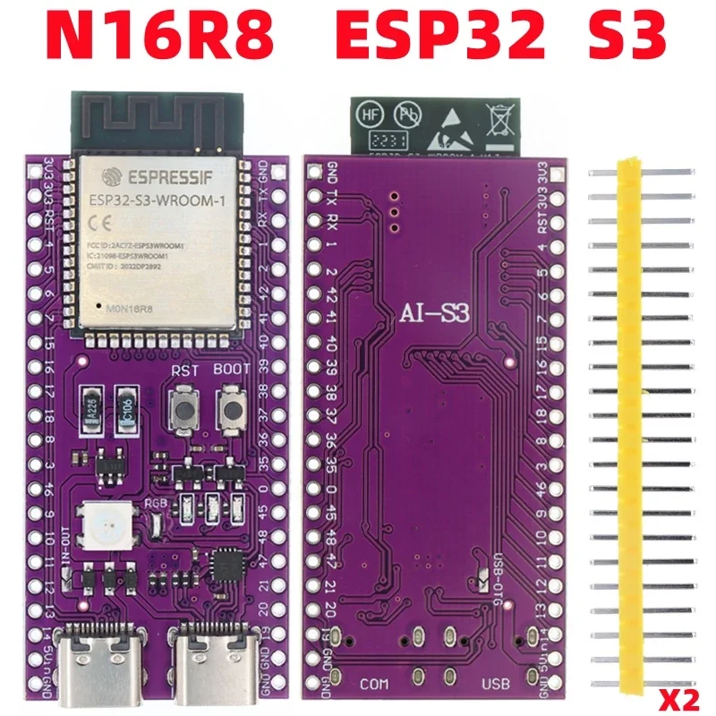
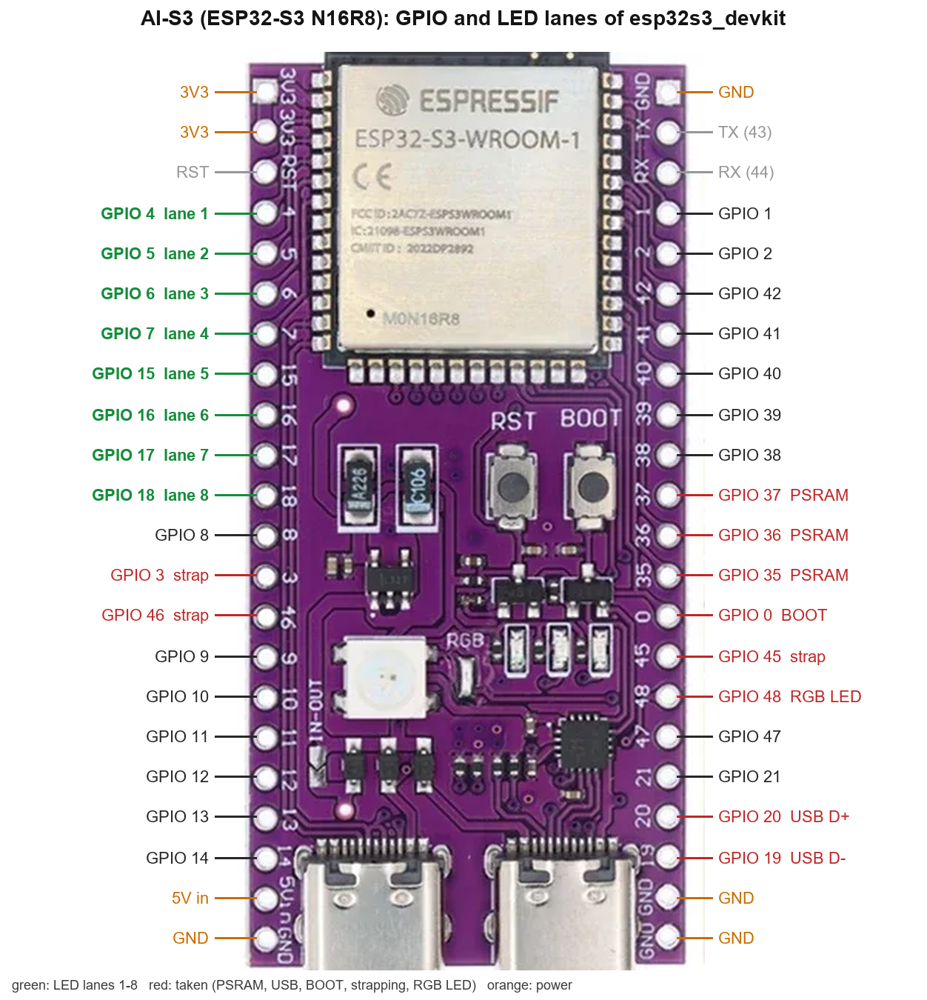
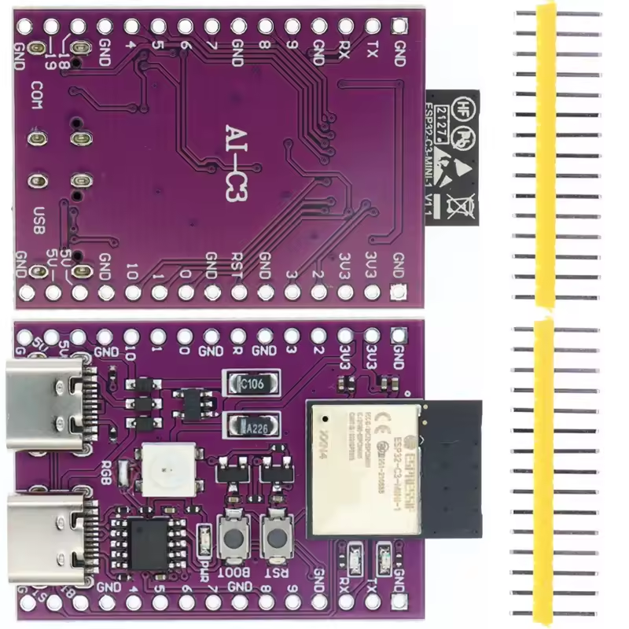

# Boards

Every board and variant the firmware is built for, with its GPIOs: the LED lanes, the optional
hardware, the pins that are taken. The code is the source (`components/board/boards/<board>.cpp`
for a board, `boards/<board>/variants/<variant>/px_board_variant.hpp` for a variant); this page
follows it and changes in the same commit as a board, a variant or a pin. How to add one:
[adding-a-board.md](adding-a-board.md).

| Build name | Hardware | Chip, flash, PSRAM | LED lanes | Tested |
| --- | --- | --- | --- | --- |
| `esp32s3_devkit` | Espressif ESP32-S3-DevKitC-1 N16R8 | ESP32-S3, 16 MB, 8 MB octal | 8 (parallel, up to 16) | as the AI-S3 |
| `esp32s3_devkit.ai_s3_test` | AI-S3 (clone, example variant) | ESP32-S3, 16 MB, 8 MB octal | 8 | yes, COM8 |
| `esp32_devkit` | Espressif ESP32-DevKitC (WROOM-32) | ESP32, 4 MB, none | 8 (parallel) | as the controller |
| `esp32_devkit.wled_controller_rev1_1` | WLED controller PCB rev 1.1 | ESP32, 4 MB, none | 4 | yes, the test matrix |
| `esp32_devkit.wled_controller_rev1_3` | WLED controller PCB rev 1.3 | ESP32, 4 MB, none | 4 | no |
| `esp32c3_devkit` | Espressif ESP32-C3-DevKitM-1 | ESP32-C3, 4 MB, none | 2 (RMT) | as the AI-C3 |
| `esp32c3_devkit.ai_c3_test` | AI-C3 (clone, example variant) | ESP32-C3, 4 MB, none | 2 | yes, COM14 |
| `esp32c6_devkit` | Espressif ESP32-C6-DevKitC-1 | ESP32-C6, 8 MB (4 used), none | 4 pins, 2 with RMT | no |

The pins are the defaults of a new device ([architecture.md](architecture.md) section 8). -1 or
"–" is a part that is not there. Buttons go to GND (low while pressed); their actions are in
[leds.md](leds.md) section 9.

## ESP32-S3: `esp32s3_devkit`

The main target: the parallel output (LCD_CAM) sends up to 16 lanes at once ([leds.md](leds.md)
section 2.2).

| Function | GPIO |
| --- | --- |
| LED lanes 1 to 8 | 4, 5, 6, 7, 15, 16, 17, 18 |
| LED supply (relay, MOSFET), on while high | 21 |
| Motion sensor, high on motion | 39 |
| I2C (BH1750, sensor modules): SDA, SCL | 8, 9 |
| LDR (ADC1) | 1 |
| Button 1 (BOOT, the hotspot button) | 0 |
| Microphone | – |

Not usable: 26 to 32 (flash), 33 to 37 (octal PSRAM), 19 and 20 (USB), 43 and 44 (UART0), 0, 3,
45 and 46 (strapping; 0 is BOOT).

### AI-S3: `esp32s3_devkit.ai_s3_test`

A purple ESP32-S3 board ("AI-S3" on the back): an ESP32-S3-WROOM-1 N16R8, two USB-C ports (COM:
a USB-to-UART chip, USB: the S3's own USB), RST and BOOT buttons, one RGB LED, 2 × 22 pins. Read
with esptool: ESP32-S3 (QFN56) rev v0.1, 16 MB quad flash (GigaDevice), 8 MB octal PSRAM, so it
runs `esp32s3_devkit`. The variant is in git as an example of a variant.

| Function | GPIO |
| --- | --- |
| LED lanes 1 to 8 | 4, 5, 6, 7, 15, 16, 17, 18 |
| LED supply, motion, I2C, LDR, microphone | – |
| Button 1 (BOOT, the hotspot button) | 0 |
| RGB LED (WS2812, not driven) | 48 |

* The printed numbers are the GPIO numbers (checked against the WROOM-1 module's pin order).
* Left header, top to bottom (front, USB at the bottom): 3V3, 3V3, RST, 4, 5, 6, 7, 15, 16, 17,
  18, 8, 3, 46, 9, 10, 11, 12, 13, 14, 5Vin, GND. The lanes sit in a row after 3V3, 3V3, RST.
* Right header: GND, TX, RX, 1, 2, 42, 41, 40, 39, 38, 37, 36, 35, 0, 45, 48, 47, 21, 20, 19, GND,
  GND.
* The RGB LED is on GPIO 48 through the place "RGB" next to it, fitted with a 0 Ω resistor
  (without it the LED is not connected); 48 is not free while the resistor is in.
* Solder jumpers: "RGB" and "IN-OUT" on the top side, "USB-OTG" on the bottom side. IN-OUT joins
  the pin 5Vin to the USB 5 V. It is open as delivered: then 5Vin is only an input and a strip fed
  from it stays dark (seen on the test unit); feed the strip from its own supply (GND to the
  board's GND) or close IN-OUT. USB-OTG feeds the 5 V to the port "USB" for USB host use.
* Tested 2026-10-22: strips on lanes 1 to 4 (4 x 1024 in the layout) with RMT and with LCD_CAM
  (29 fps); all 8 lanes with LCD_CAM (8 x 32 at 100 fps, smooth). Lanes 5 to 8 need LCD_CAM (the
  S3 has 4 RMT channels).

## ESP32: `esp32_devkit`

The parallel output (I2S in LCD mode) sends up to 16 lanes, 8 by default.

| Function | GPIO |
| --- | --- |
| LED lanes 1 to 8 | 13, 14, 16, 17, 18, 19, 23, 25 |
| LED supply, on while high | 26 |
| Motion sensor, high on motion | 34 |
| I2C: SDA, SCL | 21, 22 |
| LDR (ADC1) | 36 |
| Button 1 (BOOT, the hotspot button) | 0 |
| Microphone | – |

Not usable: 6 to 11 (flash), 1 and 3 (UART0), 0, 2, 5, 12 and 15 (strapping; 0 is BOOT); 34 to
39 are inputs only, without internal pull-ups.

### WLED controller rev 1.1: `esp32_devkit.wled_controller_rev1_1`

The WLED controller PCB ([oshwlab](https://oshwlab.com/sascha23095123423/wled-controller_copy)):
an ESP32-WROOM-32 with 4 LED outputs through a level shifter (U6), a MOSFET for the LED supply, a
motion sensor input, buttons and a footprint for an INMP441 microphone. Rev 1.1 is the test board
with the test matrix (24 x 32: lanes 1 and 2 16 x 16, lane 3 8 x 32; keep it below 10 W).

| Function | GPIO |
| --- | --- |
| LED lanes 1 to 4 (level shifted) | 27, 26, 25, 33 |
| LED supply (MOSFET), on while high | 21 |
| Supply LED | – (on the MOSFET, no GPIO) |
| Motion sensor, high on motion | 22 |
| I2C, LDR | – (21 and 22 are taken) |
| Buttons 1 to 4 | –, 35 (BTN1, darker), 34 (BTN2, brighter), 19 (BTN3, on/off, the hotspot button) |
| Microphone INMP441 (L/R to GND): SCK, WS, SD | 14, 15, 32 |

* BTN0 is the hardware reset (EN), not a GPIO: button 1 stays empty, the others keep their
  actions. The hotspot: hold BTN3 and press BTN0.
* 34 and 35 have the PCB's pull-ups (10k, 100 nF). The button GPIOs are rev 1.3's (schematic),
  checked with the console's `input`.
* From the netlist: 4 is IR_RX (the IR receiver footprint, not used). Not connected: 2, 5, 12, 17,
  18, 23 (2, 5, 12 are strapping pins). A rotary encoder would go on 17, 18, 23 (not wired).

### WLED controller rev 1.3: `esp32_devkit.wled_controller_rev1_3`

As rev 1.1, from the rev 1.3 schematic; nothing of it verified on a rev 1.3 board.

| Function | GPIO |
| --- | --- |
| LED lanes 1 to 4 (level shifted) | 27, 26, 25, 33 |
| LED supply (MOSFET), on while high | 21 |
| Supply LED | 16 |
| Motion sensor, high on motion | 22 |
| Buttons 1 to 4 | 13 (BTN0, next animation; held 3 s: restart; the hotspot button), 35 (BTN1), 34 (BTN2), 19 (BTN3) |
| Microphone INMP441: SCK, WS, SD | 14, 15, 32 |

## ESP32-C3: `esp32c3_devkit`

For small installations: 2 lanes on the RMT (2 TX channels).

| Function | GPIO |
| --- | --- |
| LED lanes 1 and 2 | 4, 5 |
| LED supply, on while high | 10 |
| Motion sensor, high on motion | 3 |
| I2C: SDA, SCL | 6, 7 |
| LDR (ADC1) | 1 |
| Button 1 (BOOT, the hotspot button) | 9 |
| Microphone | – |

Not usable: 12 to 17 (flash), 18 and 19 (USB), 20 and 21 (UART0), 2, 8 and 9 (strapping; 8 drives
the DevKitM-1's RGB LED, 9 is BOOT).

### AI-C3: `esp32c3_devkit.ai_c3_test`

A purple ESP32-C3 board ("AI-C3" on the back) in the style of the AI-S3, smaller: an
ESP32-C3-MINI-1 module, two USB-C ports (COM: a CH340K USB-to-UART chip, USB: the C3's own USB on GPIO
18 and 19), RST and BOOT buttons, one RGB LED and the LEDs PWR, RX and TX, 2 × 15 pins. Read with
esptool: ESP32-C3 (QFN32) rev v0.4, 4 MB flash in the chip (XMC), no PSRAM, so it runs
`esp32c3_devkit`. The variant is in git as an example of a variant.

| Function | GPIO |
| --- | --- |
| LED lanes 1 and 2 | 10, 4 |
| LED supply, motion sensor, I2C, LDR, microphone | – (none on the board, off in the variant) |
| Button 1 (BOOT, the hotspot button) | 9 |
| RGB LED (not driven) | 8? (as on the DevKitM-1, not checked) |

* Header with lane 2 (back, photo top; front, bottom row): GND, 19, 18, GND, 4, 5, 6, 7, GND,
  8, 9, GND, RX, TX, GND. Lane 2 (4) sits next to GND.
* Other header: GND, 5V, 5V, GND, 10, 1, 0, GND, RST, GND, 3, 2, 3V3, 3V3, GND. Lane 1 (10) sits
  next to 5V and GND. Of the other pins there, 2 is strapping and 0 and 1 take an optional 32 kHz
  crystal.
* No LED supply switch, motion sensor, LDR or I2C sensors on the board: the variant turns off the
  defaults of `esp32c3_devkit` (supply 10, motion 3, I2C 6 and 7, LDR 1), so 3, 6, 7 and 1 stay
  free and 10 is lane 1.
* The RGB LED sits behind the place "RGB" next to it, as on the AI-S3.
* Tested 2026-10-22: firmware, recovery and web UI flashed; strips on lanes 1 and 2 (GPIO 10 and
  4), 2 x 512 LEDs at 60 fps (about 2 x 600 for 50 fps). Open: the GPIO of the RGB LED, the 5V
  pins with power from USB.

## ESP32-C6: `esp32c6_devkit`

4 lane pins; the RMT has 2 TX channels, so lanes 3 and 4 wait for the parallel output (PARLIO,
not built).

| Function | GPIO |
| --- | --- |
| LED lanes 1 to 4 | 18, 19, 20, 21 |
| LED supply, on while high | 22 |
| Motion sensor, high on motion | 23 |
| I2C: SDA, SCL | 6, 7 |
| LDR (ADC1) | 1 |
| Button 1 (BOOT, the hotspot button) | 9 |
| Microphone | – |

Not usable: 24 to 30 (flash), 12 and 13 (USB), 16 and 17 (UART0), 4, 5, 8, 9 and 15 (strapping; 8
drives the board's RGB LED, 9 is BOOT).
